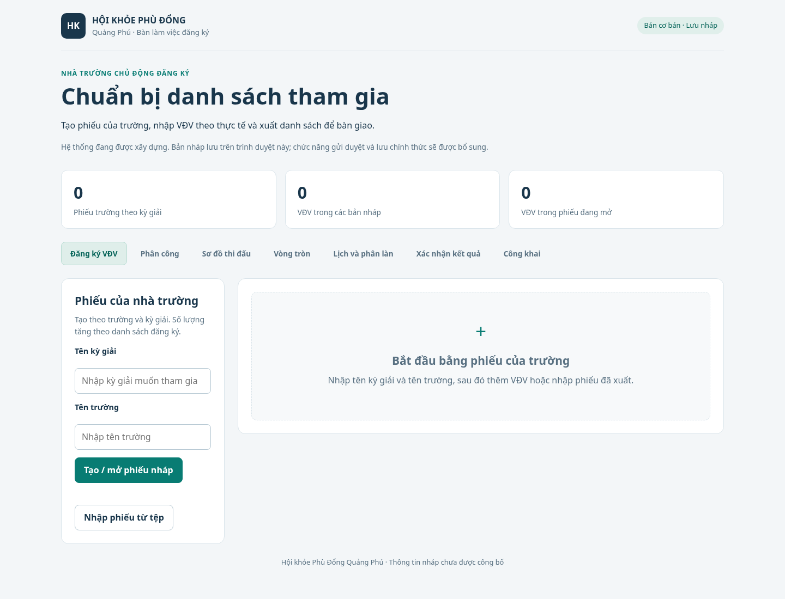
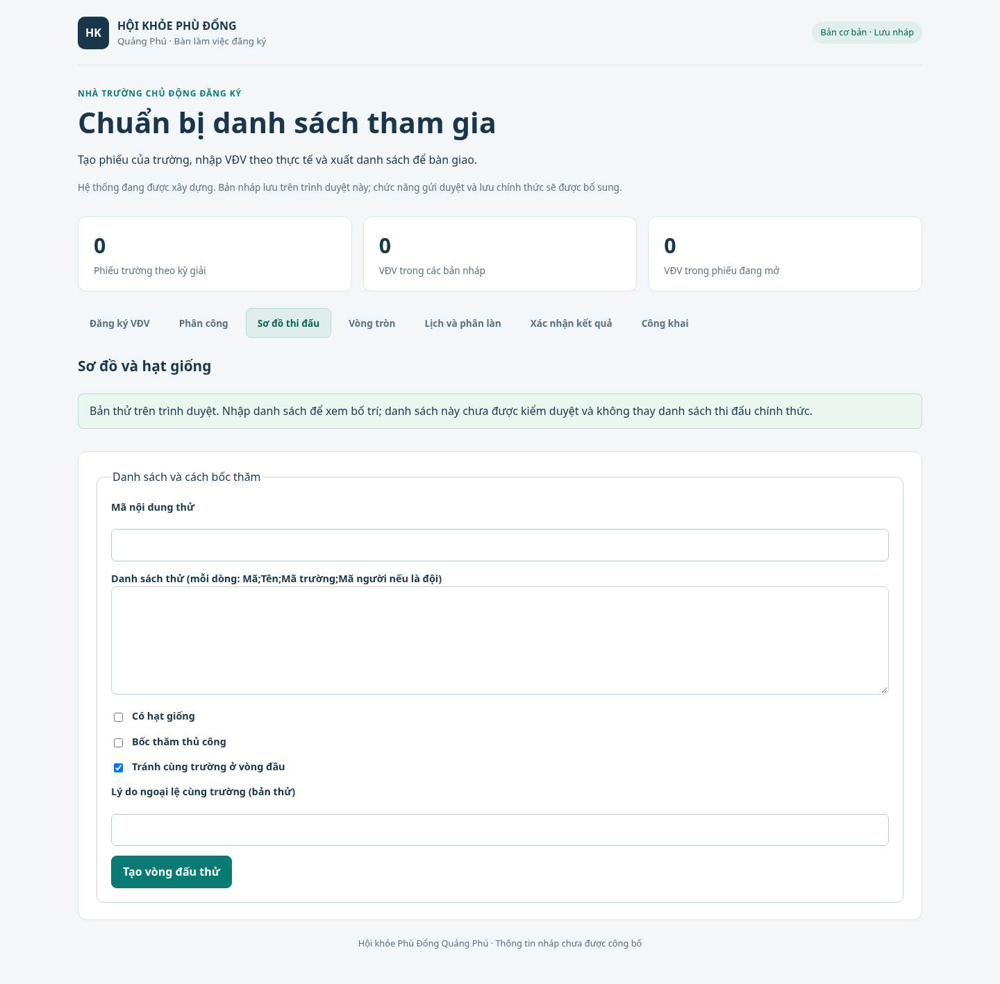
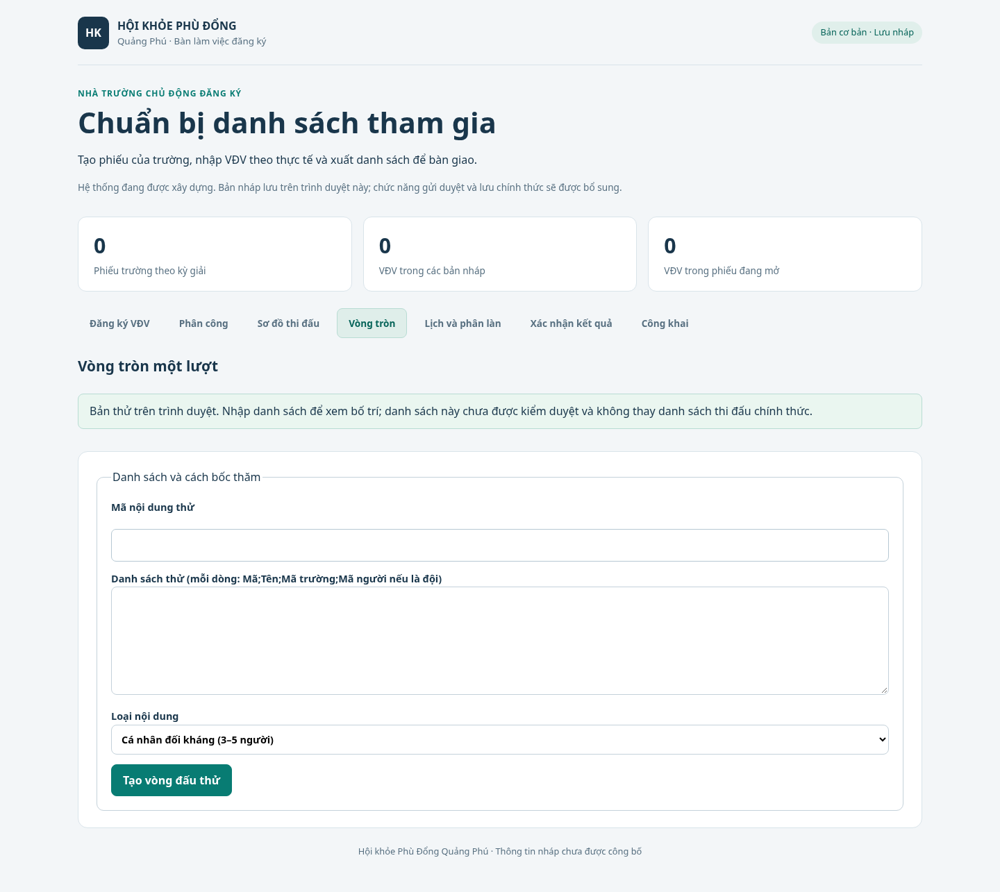
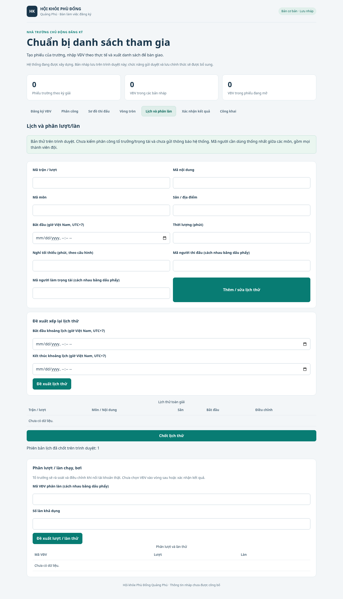

# D04 — hướng dẫn và tập huấn bản phát triển

Ảnh dưới chụp bằng Chromium từ ứng dụng nhóm C ở commit `4b32052`, viewport 1440×1100, dữ liệu rỗng/tổng hợp; hash ở [manifest ảnh](screenshots/manifest.json). Đây là tài liệu dùng để chuẩn bị tập huấn, chưa phải ảnh bản RC cuối. Khi có RC, F02 chụp lại luồng backend thật với dữ liệu tổng hợp, gắn commit đầy đủ và L02 rà soát trước nghiệm thu D04.

## Nhà trường — đăng ký nháp

Nhập tên kỳ giải và trường rồi **Tạo / mở phiếu nháp**. Nhập tên VĐV, lớp và nội dung muốn tham gia; thêm/sửa/xóa khi có danh sách thực tế. Chọn đúng phiếu trường, xuất JSON trước khi đổi máy. Xem [A04](../runbooks/A04-school-registration.md) để nhập lại tệp và xử lý lỗi lưu. Số trường/VĐV tự tăng theo phiếu, chưa có hạn mức cứng hoặc danh sách thật. Bản nháp lưu trong trình duyệt, chưa gửi nhà tổ chức, chưa được cấp mã/duyệt và chưa tạo thư mục kết quả.

## Điều phối — thử sơ đồ và vòng tròn

Mở **Sơ đồ thi đấu**, nhập mã nội dung thử và mỗi dòng `Mã;Tên;Mã trường` (đội có thể thêm danh sách mã thành viên ở trường thứ tư theo biểu mẫu). Điền hạt giống/thủ công nếu cần, tạo vòng đấu thử rồi rà vị trí ảo và tránh cùng trường. **Chốt bản thử** khóa cấu hình cục bộ; rút VĐV giữ nhánh, không tự ghi người thắng hoặc điểm. Chưa dùng danh sách đã duyệt từ backend.

Mở **Vòng tròn**, thử cá nhân 3–5 người hoặc đội đủ trường theo điều kiện nhóm C; chọn vòng và rà trận/người nghỉ. Bảng điểm chưa có kết quả chính thức từ K. Đổi tab hoặc tải lại sẽ mất bản thử nhóm C; khác với phiếu đăng ký được lưu localStorage.

## Điều phối — lịch và phân làn

Nhập mã trận/nội dung/môn/sân, giờ Việt Nam UTC+7, thời lượng, thời gian nghỉ, mã người và trọng tài. Thêm trận, sửa theo cảnh báo trùng sân/người/trọng tài và khoảng nghỉ. Thử đề xuất lịch trong khung giờ, rà thứ tự phụ thuộc; thao tác chốt hiện chỉ tạo ý định thông báo, chưa gửi thông báo thật. Nhập mã VĐV/số làn để đề xuất lượt và kiểm làn trùng. Không coi số làn thử là hạn mức đăng ký.

## Trọng tài, tổ trưởng và quản trị

**Phân công**, **Xác nhận kết quả**, **Công khai** đang là phác thảo. Buổi tập huấn nghiệp vụ chờ R/K/I và tài khoản thật; không hướng dẫn người dùng nhập/xác nhận điểm qua màn hình chưa có. Khi tích hợp: trọng tài thực hành nhập và sửa, tổ trưởng rà/xác nhận/hủy đúng phiên bản, quản trị phân công/duyệt và kiểm không nhập điểm thay trọng tài. Dùng các ca quyền, mất mạng và bản sửa chờ duyệt trong [UAT](uat.md); kiểm trực tiếp API cùng giao diện.

## Vận hành và tổ chức buổi tập huấn

O01/O02 thực hành [release/rollback](release.md) và [bàn giao](operations.md) sau khi có tích hợp cuối. F02/L02 chia buổi theo vai trò, ghi phiên bản tài liệu/commit, người tham dự, bài tập, câu hỏi, lỗi, người xử lý và xác nhận người dùng. Chỉ hoàn tất D04 sau khi tất cả vai trò có ảnh đúng RC và đã thực hành; bản hướng dẫn hiện tại không thay buổi tập huấn.
