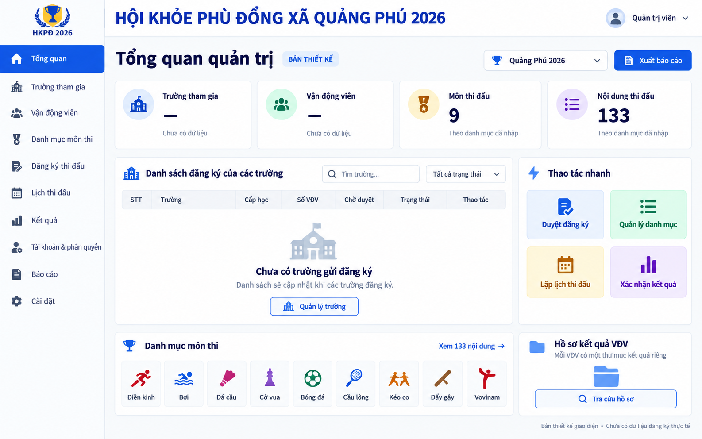

# Bản render màn hình quản trị

Ngày 13/10/2026 (Asia/Saigon). Bản thiết kế đề xuất theo yêu cầu người dùng, tạo bằng công cụ sinh ảnh; chưa được triển khai trong mã nguồn và không phải ảnh chụp ứng dụng đang chạy.

[Mở ảnh riêng](admin-dashboard-concept.png).

Giao diện đề xuất có tổng quan, quản lý trường/VĐV/danh mục, duyệt đăng ký, lịch thi đấu, kết quả, tài khoản và phân quyền, báo cáo và hồ sơ kết quả riêng cho mỗi VĐV. Danh mục hiện có 9 môn và 133 nội dung; không gán số trường/VĐV khi chưa có dữ liệu đăng ký thực tế. Các nút trong ảnh chỉ minh họa bố cục, chưa xác nhận chức năng đã hoàn thành hoặc tích hợp dịch vụ ngoài.
