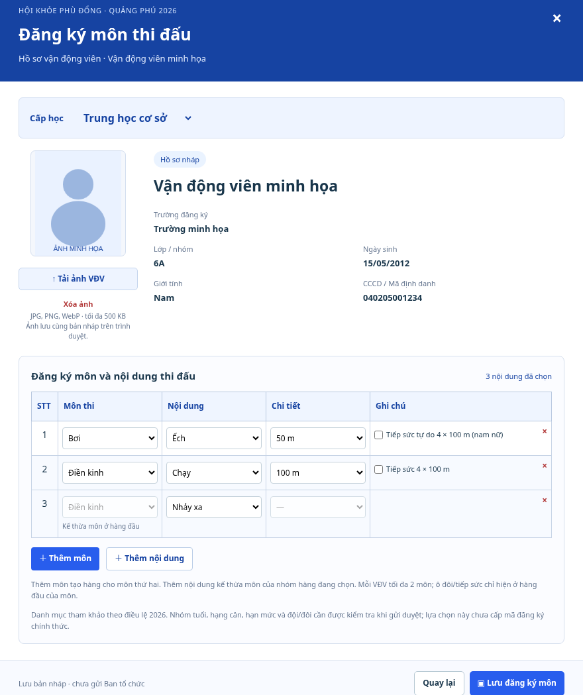

# Trạng thái VĐV và đăng ký môn

Ngày 12/10/2026 (Asia/Saigon). Bổ sung theo yêu cầu người dùng: cột Trạng thái với biểu tượng cây bút/đĩa mềm, thùng rác và quyển sổ **Đăng ký môn**. Giữ nguyên tám cột hồ sơ trước đó; bảng hiện có chín cột.

[Xem bảng VĐV với cột Trạng thái](bang-vdv-trang-thai.png). [Màn hình ban đầu có một hàng trống](dang-ky-mon-ban-dau.png).

## Thao tác

- Cây bút mở sửa dòng đã lưu; đĩa mềm lưu riêng dòng đó, giữ các dòng khác đang sửa hoặc chờ xóa. Dòng mới nhập trực tiếp, chỉ lưu khi có tên. Lưu riêng giữ thứ tự các VĐV. Nút **Lưu danh sách** vẫn lưu toàn bộ bản đang nhập.
- Thùng rác xóa VĐV khỏi bảng đang nhập; bấm **Lưu danh sách** để lưu việc xóa. Trạng thái thể hiện lưu nháp/đang lưu/lỗi lưu, không gán trạng thái duyệt chính thức.
- Quyển sổ/**Đăng ký môn** mở đúng hồ sơ VĐV. Cửa sổ hiển thị ảnh, trường, lớp, ngày sinh, giới tính, mã định danh; Cấp học nằm trên phần thông tin học sinh. Phần đăng ký là bảng **STT | Môn thi | Nội dung | Chi tiết | Ghi chú** theo PDF đã gửi (trang 40–43). Ban đầu có một hàng trống; nút **Thêm môn** tạo nhóm hàng cho môn thứ hai, **Thêm nội dung** tạo hàng kế thừa môn của nhóm đang chọn. Chọn môn/nội dung/chi tiết bằng dropdown; ví dụ Bơi → Ếch → 50 m. Ô đôi/tiếp sức/nam-nữ chỉ hiện ở hàng đầu của môn trong cột Ghi chú. Có thể xóa hàng, đổi môn áp dụng cả nhóm và xóa các nội dung không còn phù hợp. Chặn môn thứ ba theo quyết định trong PDF (trang 36–37); kiểm tra một dòng đang nhập đủ lựa chọn và không trùng trước lưu.
- **Tải ảnh VĐV** nhận JPG/PNG/WebP tối đa 500 KB, tối đa 4.000 × 4.000 pixel. Kiểm MIME, chữ ký tệp và khả năng giải mã ảnh khi tải bằng cửa sổ này. Xóa ảnh hoặc thay bằng ảnh mới được hỗ trợ. Ảnh và nội dung chọn chỉ vào hồ sơ khi bấm **Lưu đăng ký môn**. Đóng cửa sổ có thay đổi chưa lưu sẽ hỏi bỏ thay đổi; rời trang có cảnh báo. Khi phiếu thay đổi trong lúc cửa sổ mở, giữ bản đang nhập và chặn ghi đè.

## Danh mục và lưu trữ

Các lựa chọn tham khảo được chép từ Chương II `docs/business/sources/dieu-le-2026.txt`: Điền kinh, Bơi, Cầu lông, Đá cầu, Cờ vua, Bóng đá, Kéo co, Đẩy gậy và Vovinam. Chọn cấp học/giới tính để hiển thị lựa chọn phù hợp với phần điều lệ đã có; chưa phải snapshot danh mục được duyệt. Chưa kiểm đầy đủ nhóm tuổi, hạng cân, quota, thành viên đội/đôi hoặc các ngoại lệ riêng của kỳ giải. Các lựa chọn là nguyện vọng nháp; chỉ áp dụng kiểm tra số môn, lựa chọn hợp lệ và trùng trong cửa sổ này, chưa thay toàn bộ kiểm điều kiện chính thức; không tự tạo đội, cấp mã hay gửi duyệt. Danh mục đầy đủ 133 nội dung trong plan vẫn cần tài liệu cấu hình chính thức như baseline đã ghi.

Ảnh raster dạng data URL và `eventSelections` được lưu cùng bản nháp bằng DraftWriter/Web Locks/CAS hiện có. Portable JSON mới dùng v3 và whitelist; v1/v2 cũ vẫn đọc được và giữ định dạng nếu chưa thêm dữ liệu mới. Excel chỉ chứa các cột hồ sơ và chuỗi nội dung tóm tắt, không mang ảnh hoặc cấu trúc lựa chọn; dùng JSON v3 để bàn giao cả ảnh/nguyện vọng. Browser storage có giới hạn dung lượng; khi quota/conflict xảy ra, ứng dụng giữ dữ liệu trong phiên, báo chưa lưu an toàn và cho xuất JSON. Cần cập nhật các tab dùng bản ứng dụng cũ trước khi tiếp tục.

Không gọi Drive, Supabase hoặc Netlify; ảnh chưa được tải lên máy chủ. Nội dung trên cửa sổ và trạng thái bảng không phải xác nhận đủ điều kiện thi đấu. Không đưa dữ liệu nháp hoặc ảnh vào DTO công khai.

## Kiểm chứng

Thêm 9 test trong phần thao tác/đăng ký môn so với main sau PR #24. Kiểm mới về bảng đạt 9 test/2 file; hồi quy trước đó tiếp tục chạy trong full check: lưu riêng không ghi nhầm dòng khác, giữ thứ tự và việc xóa đang chờ, chọn/bỏ/mở lại môn đúng VĐV, cảnh báo đóng và chặn snapshot cũ, chặn tệp ảnh không hỗ trợ, round-trip ảnh/lựa chọn bằng JSON v3 và storage có lock, chặn payload sai hoặc trùng. Native dialog được shim trong jsdom; browser thực được kiểm riêng.

`npm run check`: 713 test/51 file, lint/typecheck/contracts/build đạt. Secret scan đạt. Chromium thực xác nhận đủ chín cột trên desktop, tải ảnh PNG minh họa, thêm môn thứ hai, thêm nội dung kế thừa môn, lưu rồi reload/mở lại khôi phục ảnh và đúng ba lựa chọn thuộc hai môn, không có uncaught JavaScript exception. Ảnh chụp là ứng dụng thực tế; mọi hồ sơ/ảnh đều là dữ liệu minh họa.
