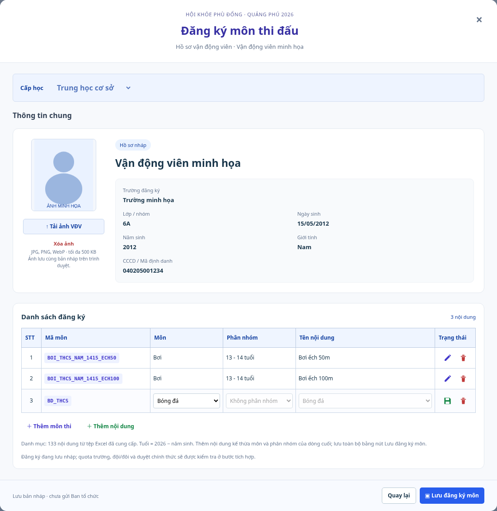

# Đăng ký môn bằng danh mục Excel

Ngày 13/10/2026 (Asia/Saigon). Dùng đủ 133 nội dung trong Excel, kết nối với hồ sơ học sinh đang mở và thiết kế theo mẫu TSX được cung cấp.

[Một hàng trống ban đầu](dang-ky-mon-ban-dau.png).

Thông tin chung hiển thị cấp học, năm sinh, giới tính, tên/lớp/trường và ảnh. Bảng có đúng sáu cột **STT, Mã môn, Môn, Phân nhóm, Tên nội dung, Trạng thái**. STT theo vị trí dòng, Mã môn dùng mã Excel thực. Nút đĩa mềm kiểm tra và khóa dòng trong cửa sổ đang nhập; cây bút mở sửa, thùng rác xóa và luôn giữ một hàng trống khi xóa hết. **Lưu đăng ký môn** lưu toàn bộ vào hồ sơ nháp. Thêm nội dung kế thừa môn/nhóm của dòng cuối; đổi môn/nhóm xóa các lựa chọn phụ thuộc. Trạng thái ở bảng VĐV phản ánh lưu nháp/lỗi lưu, không tự gán duyệt chính thức.

Giữ tải/xóa ảnh, guard snapshot cũ, cảnh báo rời trang và Web Locks/CAS. Mã cũ không còn phù hợp với hồ sơ hiện tại được đánh dấu cần chọn lại; dữ liệu không bị xóa âm thầm. Xem [quy tắc dữ liệu và giới hạn](../../catalog/README.md).

Kiểm tập trung: 34 test/5 file đạt, gồm đối chiếu 133 dòng Excel/SHA, Bóng đá nam TH/THCS và nữ, tuổi theo nhãn nhóm, mixed-sex, chọn thiếu/sai/trùng, giới hạn hai môn, cascade, kế thừa môn/nhóm, sửa/lưu/xóa, giữ lựa chọn cũ chưa đối chiếu được và round-trip JSON v4/storage. `npm run check` đạt 722 test/52 file, gồm catalog check, lint/typecheck/contracts/build. Secret scan đạt.

Ảnh là ứng dụng thực tế trên Chromium, chỉ dùng hồ sơ và ảnh minh họa. Browser kiểm tra tải ảnh, lưu ba mã thật (hai nội dung Bơi + Bóng đá THCS), reload giữ ảnh/mã, nữ không có Bóng đá để chọn, nam Tiểu học chỉ điền BD_TH, THCS chỉ điền BD_THCS, kế thừa môn/nhóm và đúng sáu tiêu đề. Nam Tiểu học chỉ có Điền kinh 60 m, bật xa và tiếp sức 4 × 50 m; không có `DK_THCS_NAM_TC_1500M`. Test xác nhận lưu mã 1500 m THCS trong hồ sơ Tiểu học bị từ chối. Không phải nghiệm thu giao dịch đăng ký chính thức hoặc triển khai provider.
