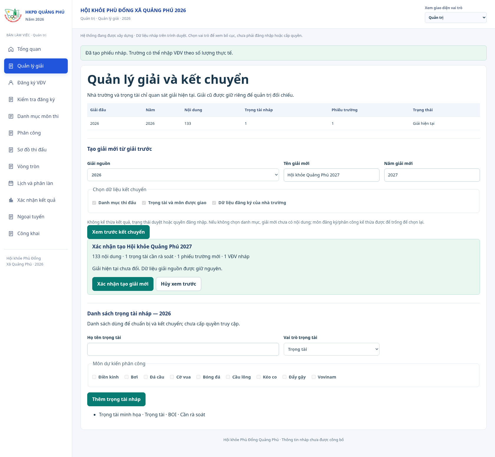
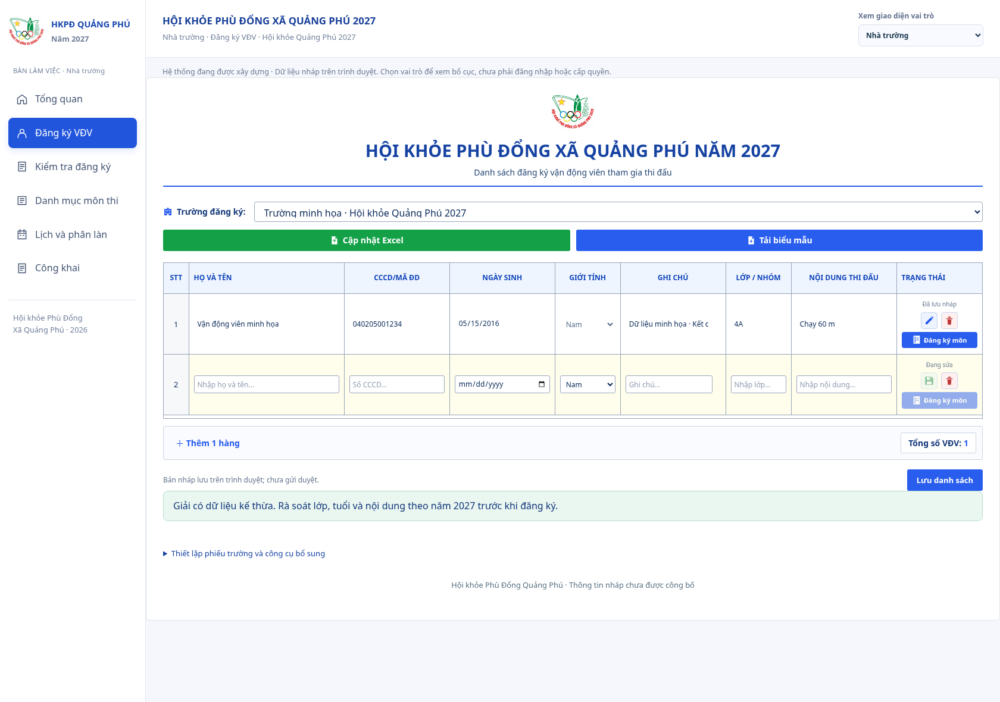

# Quản lý giải và kết chuyển

Ảnh chụp ứng dụng thực tế ngày 13/10/2026 (Asia/Saigon), dùng một trường/VĐV và trọng tài minh họa trên Chromium. Không phải dữ liệu tham gia thực tế.

- [Xem trước ba lựa chọn kết chuyển](xem-truoc-ket-chuyen.png)
- [Quản lý giải sau khi tạo giải mới](quan-ly-giai.png)
- [Nhà trường chỉ có giải hiện tại 2027](nha-truong-giai-hien-tai.png)

`npm run check` đạt 735 test/55 file. Năm test mới kiểm tám tổ hợp kết chuyển, dữ liệu nguồn/ID mới, trùng tên/năm sai, CAS/quota, giải hiện tại theo vai trò, xem trước/xác nhận và reload. Smoke dev/staging/worker/shutdown và secret scan đạt.

Chromium kiểm xem trước không ghi dữ liệu, xác nhận tạo giải với ba phần lựa chọn, giữ nguồn và ID độc lập, kích hoạt giải tách riêng, reload giữ giải mới, nhà trường chỉ thấy phiếu 2027 và kiểm tuổi theo 2027 (học sinh TH sinh 2016 không được giữ nội dung TH khi đã 11 tuổi). Danh sách trọng tài nháp kế thừa không tự cấp quyền. Không có exception ứng dụng.

Phạm vi vẫn là bản nháp cục bộ; xem [quy tắc di trú, kiểm lại hồ sơ và giới hạn backend](../../ui-references/current-edition-carry.md).
