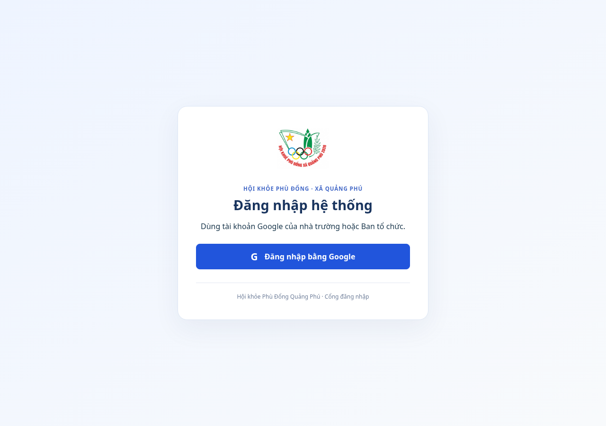
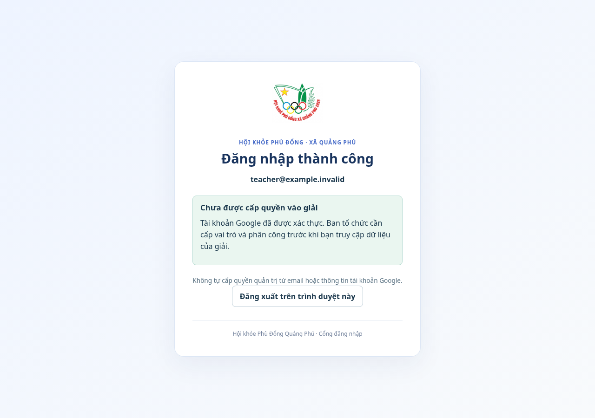

# Đăng nhập Google qua Supabase

Ngày 15/10/2026 (Asia/Saigon). Ảnh chụp mã ứng dụng thực tế trên Chromium. Các request Supabase được giả lập bằng CDP, dùng email `teacher@example.invalid` và credential tổng hợp, không phải lượt consent Google hoặc tài khoản người dùng thật.

- [Màn đăng nhập Google](dang-nhap-google.png)
- [Danh tính đã xác minh, chưa được cấp quyền](tai-khoan-cho-cap-quyen.png)

Browser chạy SDK Supabase thật với server Auth giả lập: nút Google tạo PKCE challenge, nhận code ở root, trao đổi có code verifier, gọi getUser, xóa code khỏi URL, reload xác minh lại phiên và đăng xuất. `user_metadata.role=admin` giả lập không mở workspace; màn nhỏ 390 px không tràn chiều rộng, không có exception. Chưa thực hiện Google consent hoặc kiểm chứng cấu hình project thật trên production.

Kiểm thử toàn dự án đạt 746 test/56 file; 11 test auth/config kiểm StrictMode/code một lần, verify server, callback lỗi/implicit, redirect cùng origin, phiên cũ/signout và cấu hình public/private key. Smoke dev/staging/API/worker/shutdown và secret scan đạt.

Sau merge/deploy cần thực hiện [checklist đăng nhập bằng tài khoản Google thật](../../runbooks/supabase-google-login.md). Cấp quyền/giải/phân công trên máy chủ là phần còn phải nối, không tự cấp admin từ email hoặc metadata.
