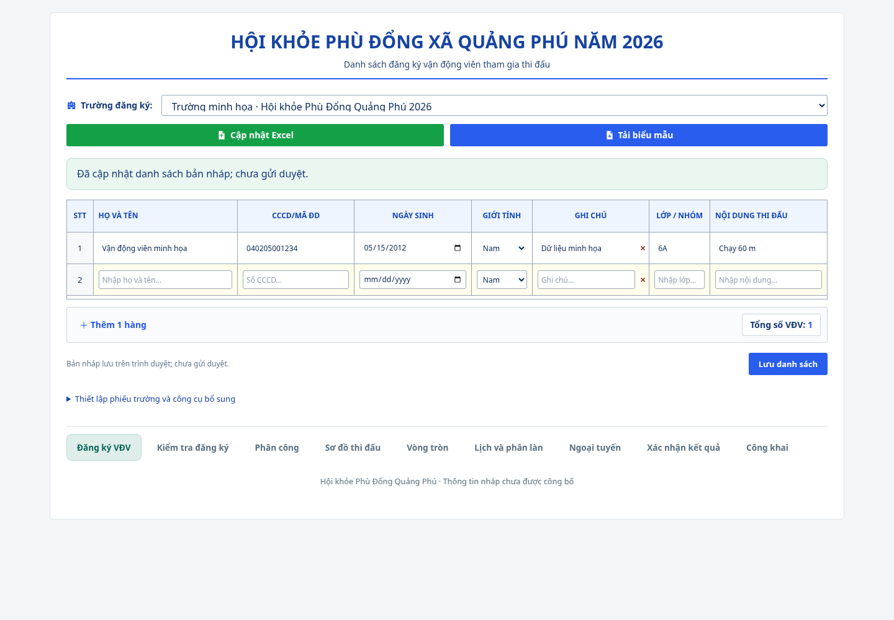

# Giao diện đăng ký theo bảng

Thực hiện theo ảnh mẫu người dùng cung cấp ngày 12/10/2026. Tiêu đề Hội khỏe Phù Đổng xã Quảng Phú năm 2026, chọn trường, nút Excel xanh lá/xanh dương và bảng tám cột: STT, họ tên, CCCD/mã định danh, ngày sinh, giới tính, ghi chú, lớp/nhóm, nội dung thi đấu. Thêm/xóa hàng, tổng số VĐV và lưu danh sách nháp; không điền sẵn trường hoặc hồ sơ thật.

[Bản điện thoại](dang-ky-van-dong-vien-mobile.png). Trên màn hình hẹp, bảng cuộn ngang trong khung; trang không tràn ngang. Trình duyệt quyết định cách hiển thị trường lịch theo ngôn ngữ/thiết bị; dữ liệu lưu ISO YYYY-MM-DD và Excel dùng dd/mm/yyyy.

## Sử dụng

1. Chọn phiếu trường. Nếu chưa có, mở **Thiết lập phiếu trường và công cụ bổ sung** để nhập tên trường/kỳ giải và tạo phiếu. Danh sách không bị giới hạn theo số trường trong fixture.
2. Nhập từng dòng hoặc tải biểu mẫu `.xlsx`, điền danh sách rồi chọn **Cập nhật Excel**. Nhập Excel bổ sung vào bảng đang nhập, không thay toàn bộ phiếu. Bấm **Lưu danh sách** để kiểm tra và lưu bản nháp. Có thể xóa hàng bằng nút ×.
3. Họ tên bắt buộc. Mã định danh, ngày sinh, giới tính và ghi chú là thông tin nháp; chưa thay thế kiểm tra điều kiện đăng ký chính thức. Nếu nhập mã định danh phải đủ 12 chữ số, không trùng trong phiếu; ô Excel phải là văn bản để giữ số 0 đầu. Ngày sinh cần là ngày tồn tại và không trong tương lai. Ghi chú tối đa 2.000 ký tự.
4. Dòng mới mặc định Nam, dòng cũ chưa có giới tính hiển thị `--`, không tự suy đoán. Bảng giữ phần đang nhập khi chuyển trường. Chuyển màn khác có cảnh báo bỏ thay đổi; rời trang có beforeunload. Khi công cụ cũ sửa cùng phiếu, bảng chặn ghi đè và giữ bản đang nhập để đối chiếu.

Lớp/nhóm và nội dung thi đấu có ô nhập ngay trong bảng, được lưu cùng hồ sơ và đồng bộ với hai cột Excel tương ứng. Biểu mẫu mới dùng tiêu đề LỚP / NHÓM và NỘI DUNG THI ĐẤU; vẫn đọc các biểu mẫu cũ dùng LỚP/NHÓM và NỘI DUNG DỰ KIẾN, theo cùng thứ tự cột. Không chấp nhận công thức trong các ô thông tin hồ sơ. Nhập lỗi không ghi một phần dữ liệu. Mỗi tệp tối đa 5 MB/2.000 dòng nhằm giới hạn xử lý trong browser; không giới hạn tổng số VĐV của trường, có thể chia nhiều tệp. ExcelJS 4.4.0 được tải động khi dùng Excel, không tải cùng trang ban đầu.

## Tương thích và kiểm chứng

Giữ DraftWriter/Web Locks/CAS từ PR #21 và cách bảo toàn dữ liệu khi quota/conflict/corrupt. Phiếu portable v1 cũ vẫn đọc/xuất như cũ; phiếu có thông tin mới hoặc lớp/nội dung chưa nhập dùng portable v2. Stable local IDs chỉ nằm trong browser storage, không xuất. Export whitelist các trường hồ sơ; không thêm quyền duyệt, ID máy chủ hoặc liên kết riêng tư. Bản ứng dụng cũ không đọc được các trường mới, cần tải lại sau cập nhật; không tự sửa bytes lỗi. Các màn khác giữ bố cục cũ và được truy cập qua thanh chức năng dưới bảng.

Thêm 8 test về ô nhập, đổi trường, lưu/khôi phục, lỗi dữ liệu, xung đột công cụ và Excel. Các test liên quan đăng ký gồm 23 test; toàn bộ đạt 704 test/49 file. Typecheck, lint, contract checks, build, secret scan và managed process smoke đạt. Một lần chạy đồng thời smoke/build gây timeout ở test A01 cũ; chạy lại toàn bộ riêng đã đạt, không thay assertion hoặc timeout.

Bổ sung ngày 12/10/2026 theo xác nhận của người dùng: hiển thị đủ tám cột, nhập/sửa/lưu lớp và nội dung ngay trong bảng. Ảnh desktop mới chụp ở viewport 1440 px, kiểm tra cả tám cột nằm trong khung mà không cần cuộn; mobile có gợi ý kéo ngang. Kiểm tra reload xác nhận lớp/nội dung vẫn giữ nguyên.

Ảnh là ứng dụng thực tế chạy trên Chromium, chỉ dùng dữ liệu minh họa. Phiên browser kiểm tra tạo phiếu, lưu các trường mới, tải tệp XLSX thực, nhập XLSX, tải lại giữ dữ liệu, không có uncaught JavaScript exception và không tràn trang ở viewport 390 px. Không kết nối Drive, Supabase hoặc Netlify; không đánh dấu gửi duyệt/UAT nghiệp vụ hoàn thành.
