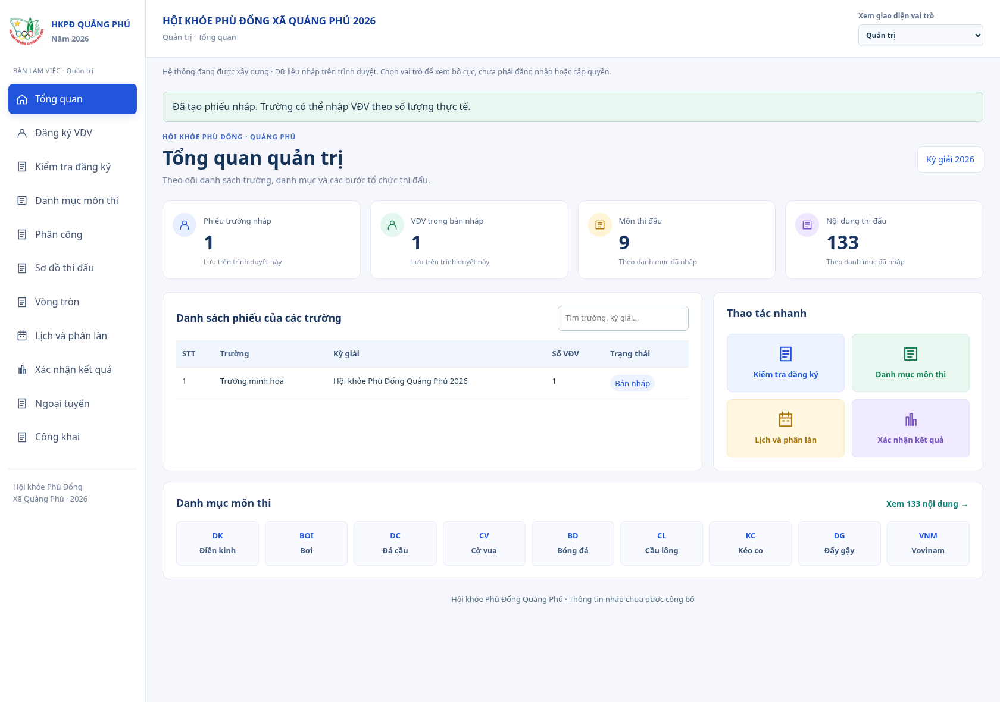
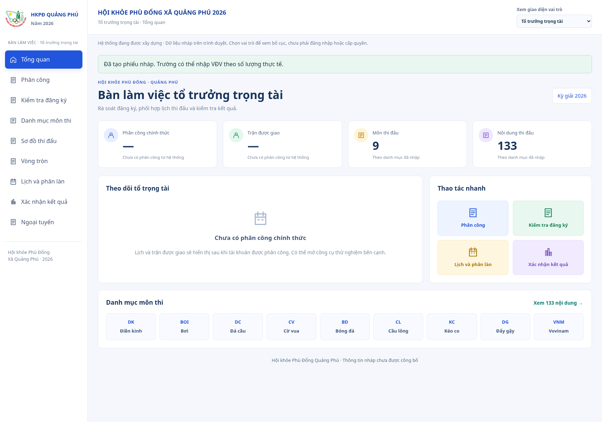
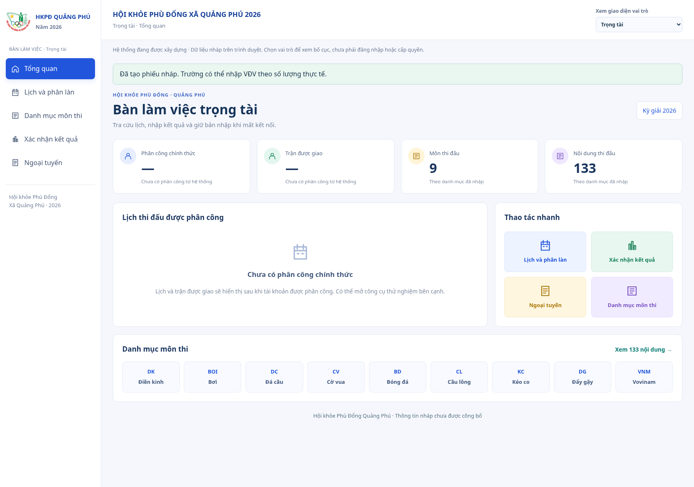
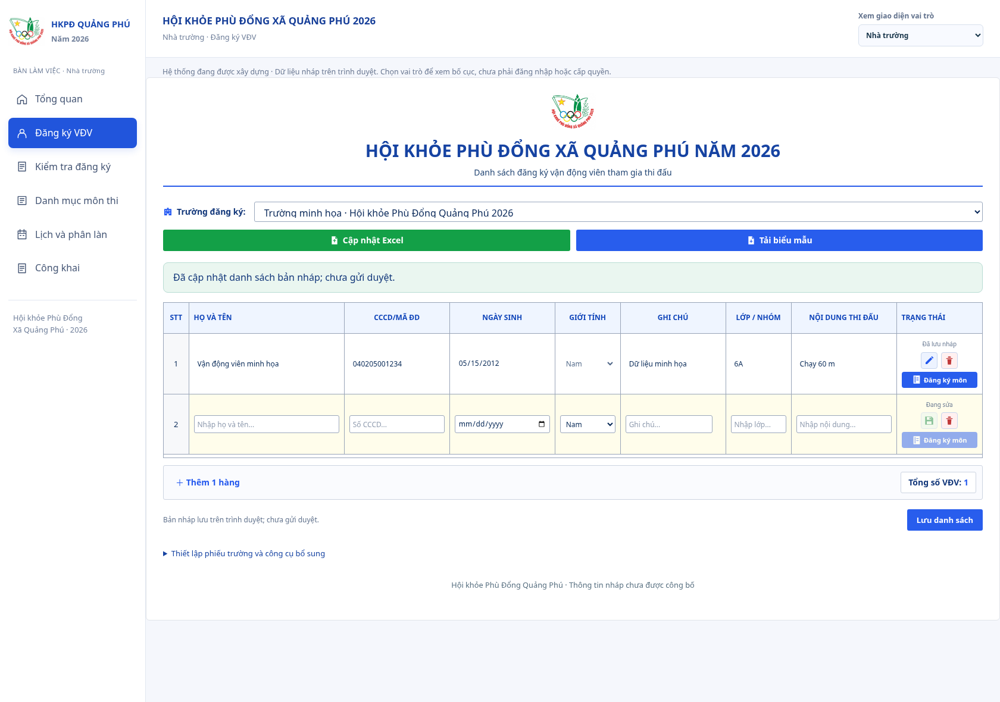

# Giao diện bốn vai trò

Ảnh lịch sử của PR #28. Bàn tổ trưởng/trọng tài hiện đã được sửa để chỉ thấy môn theo phân công; xem [ảnh và quy tắc mới](../staff-assigned-sports-2026-10-13/README.md).

Ngày 13/10/2026 (Asia/Saigon). Ảnh chụp ứng dụng thực tế trên Chromium từ mã nguồn của nhánh này, dùng một phiếu trường/VĐV minh họa trong trình duyệt thử nghiệm. Logo là ảnh nguyên bản người dùng gửi trong ZIP; đây không phải bản render sinh ảnh của PR #27.

| Vai trò             | Ảnh                                         |
| ------------------- | ------------------------------------------- |
| Quản trị            | [Mở ảnh quản trị](quan-tri.png)             |
| Tổ trưởng trọng tài | [Mở ảnh tổ trưởng](to-truong-trong-tai.png) |
| Trọng tài           | [Mở ảnh trọng tài](trong-tai.png)           |
| Nhà trường          | [Mở ảnh nhà trường](nha-truong.png)         |

## Kiểm tra

`npm run check` đạt 726 test/53 file, lint, typecheck, catalog/contracts và build. Bốn test mới kiểm điều hướng theo vai trò, giữ bản nháp khi hủy chuyển trang/vai trò, dùng số liệu nháp thực và lọc danh mục. Smoke dev/staging kiểm API/web/worker, logo JPEG được phục vụ và shutdown.

Browser kiểm bốn vai trò, logo tải được, đủ 133 dòng tra cứu, mở workspace kết quả, giữ sáu cột đăng ký môn và bản nháp đã lưu sau khi chuyển vai trò; viewport 390 px không tràn chiều rộng trang. Các bảng rộng có vùng cuộn riêng.

Bộ chọn vai trò chỉ để xem giao diện, chưa thay đăng nhập/phân quyền máy chủ. Số phiếu/VĐV là dữ liệu nháp minh họa; chưa có số đăng ký đã duyệt hoặc trận được phân công chính thức. Xem [phạm vi và bàn giao](../../ui-references/role-workspaces.md).
