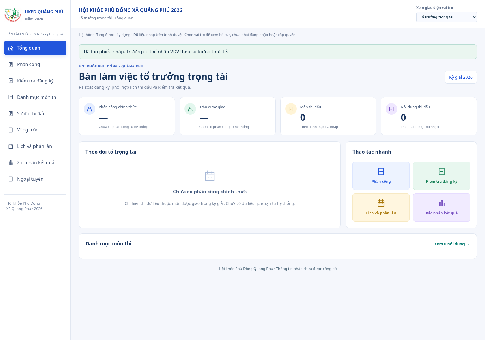
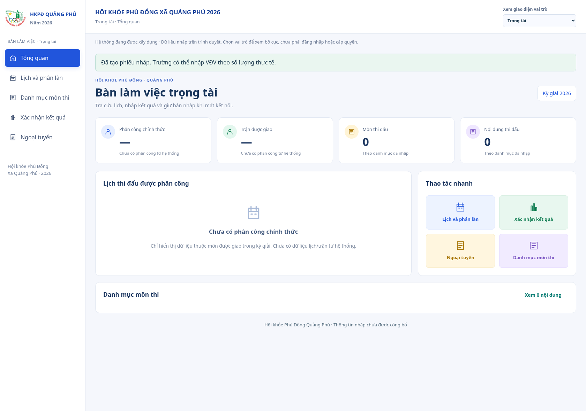

# Bàn trọng tài chỉ quan sát môn được phân công

Ảnh ứng dụng thực tế ngày 13/10/2026, Chromium, hồ sơ minh họa. Entrypoint chưa nối phiên phân công thật, nên tổ trưởng/trọng tài có 0 môn; không mặc định thấy 9 môn/133 nội dung. Đây là trạng thái chưa phân công, không phải lỗi mất danh mục.

- [Tổ trưởng trọng tài](to-truong-trong-tai.png)
- [Trọng tài](trong-tai.png)

`npm run check` đạt 730 test/54 file. Bốn test phạm vi phân công kiểm actor/vai trò/kỳ giải/phê duyệt, mapping UUID, thu hồi/mất phiên, danh mục Bơi riêng cho tổ trưởng và Bóng đá riêng cho trọng tài; không mount các workspace thử chứa dữ liệu chung. Browser kiểm preview chưa phân công có 0 dòng danh mục, trang quan sát riêng, logo/sáu cột đăng ký vẫn giữ, chuyển vai trò không đổi bản đã lưu và màn nhỏ không tràn chiều rộng.

Xem [quy tắc và giới hạn kết nối phiên/API](../../ui-references/staff-assigned-sports.md). Không dùng kết quả kiểm UI để tuyên bố đã kết nối xác thực hoặc phân quyền API thật.
