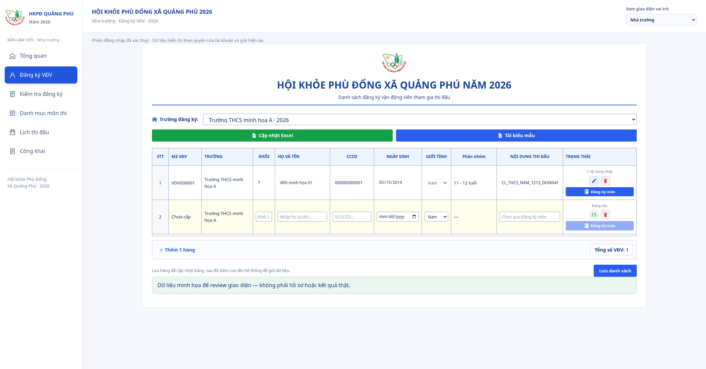
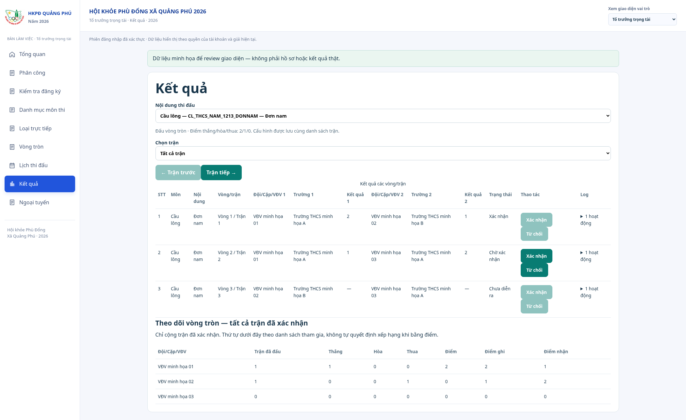
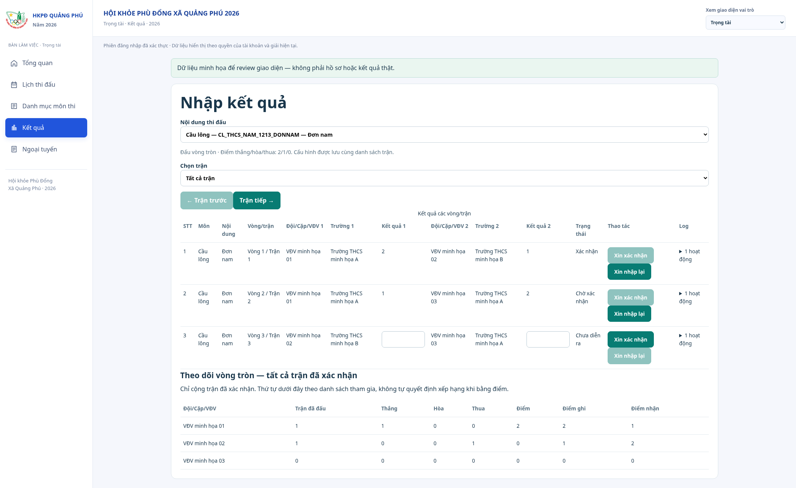

# Giao diện đăng ký và kết quả — 16/10/2026

Ảnh chụp các component React hiện tại bằng Chromium, dùng dữ liệu giả, không phải dữ liệu giải thật hoặc bằng chứng đã triển khai Netlify. Bảng rộng hỗ trợ cuộn ngang trên màn hình nhỏ. Các nút trong bộ ảnh dùng mock, không ghi Supabase/Drive.

- [Nhà trường: bảng đăng ký 11 cột và hàng trống](school.png).
- [Tổ trưởng: duyệt kết quả và theo dõi vòng tròn](chief.png).
- [Trọng tài: nhập điểm, xin xác nhận, xin nhập lại](referee.png).

Đây là ảnh riêng bảng đăng ký, không bao gồm các nút lưu lên hệ thống/gửi duyệt của khung vận hành bên ngoài. Xem [hướng dẫn chức năng và SQL 007–008](../../runbooks/student-import-match-results.md).

